<div align="center">

# My Tools Hub

**46 private tools that never leave your browser.**<br>
Text, data, documents, images and QR codes. No uploads, no accounts, works offline.

[**Open the live site**](https://my-tools-hub-app.netlify.app/) &nbsp;·&nbsp; [Browse the tools](#all-tools) &nbsp;·&nbsp; [Run it yourself](#run-it-yourself)

[](https://github.com/vasylm1/my-tools-hub/actions/workflows/ci.yml)


[](LICENSE)

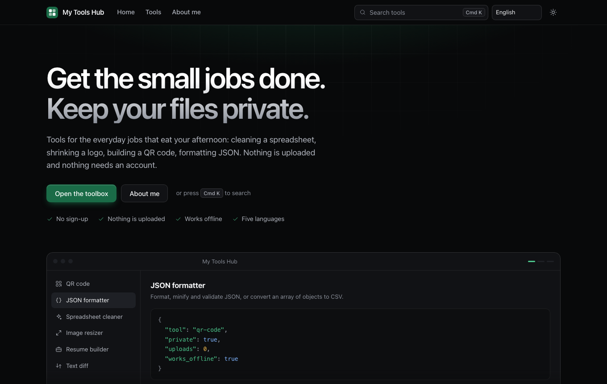

</div>

## Why you will like it

- **Your files stay yours.** Everything is processed by your browser. Nothing you type, open or drop in is uploaded, so you can safely use it on contracts, customer lists and unreleased designs.
- **Made for real jobs.** The landing page groups tools by what you are trying to do (marketing and sales, data and reporting, developers and admins, everyday documents) and shows three of them working in a live, looping preview.
- **Fast, and works offline.** Open it once and every tool keeps working without a connection. There is no framework and no build step, so tools load on demand and open instantly.
- **Speaks your language.** English, Polish, German, Ukrainian and Simplified Chinese, switchable at any time.
- **Built for everyone.** Keyboard friendly, visible focus, light and dark themes, readable at 400% zoom, and checked against WCAG 2.1 AA with automated tests.
- **Honest about privacy.** The only outside request a tool makes is the exchange-rate lookup in the currency converter. Page statistics come from a self-hosted, cookieless Umami that never sees tool inputs.
- **Open and simple.** Plain HTML, CSS and JavaScript with zero runtime dependencies. Read it, audit it, run it yourself, or add a tool in a few lines.

## A look inside

<table>
  <tr>
    <td width="50%">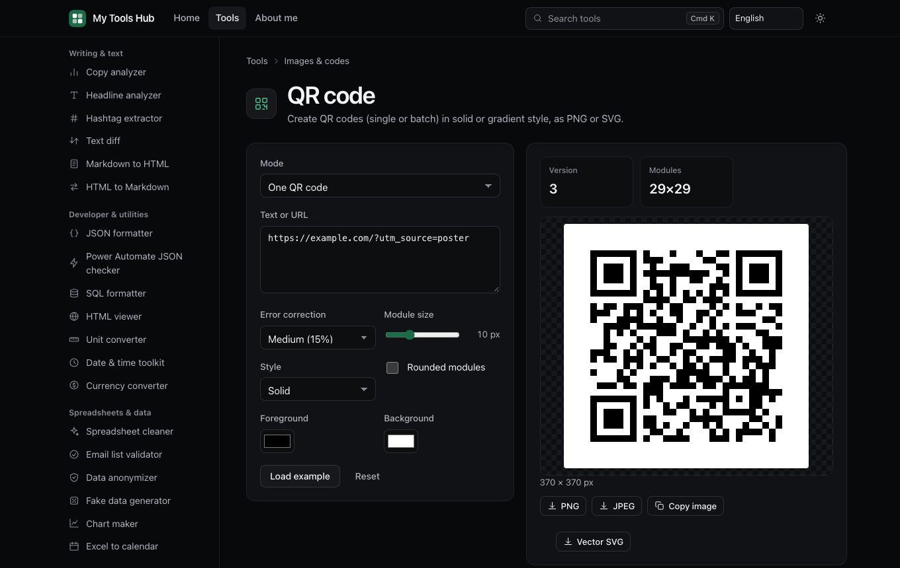<br><sub><b>QR codes</b> in solid or gradient style, single or batch, as PNG or SVG. Verified against an independent decoder.</sub></td>
    <td width="50%">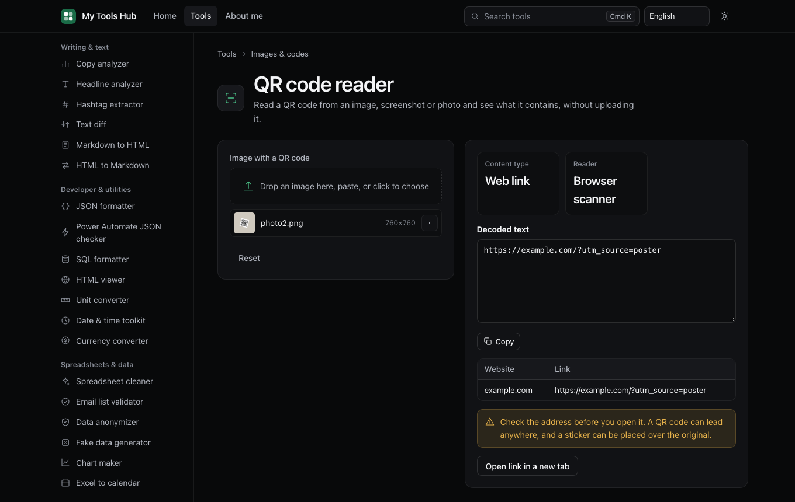<br><sub><b>QR code reader</b> finds a code in a screenshot or photo, even rotated, and tells you what is inside before you open it.</sub></td>
  </tr>
  <tr>
    <td>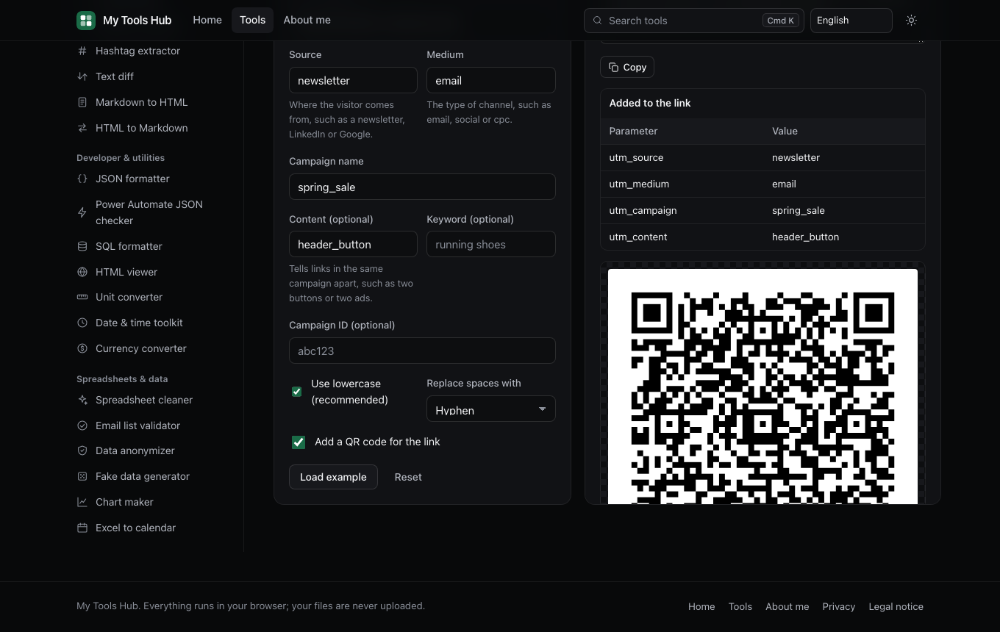<br><sub><b>Campaign link builder</b> adds consistent UTM tags, one link at a time or from a spreadsheet, with an optional QR code.</sub></td>
    <td>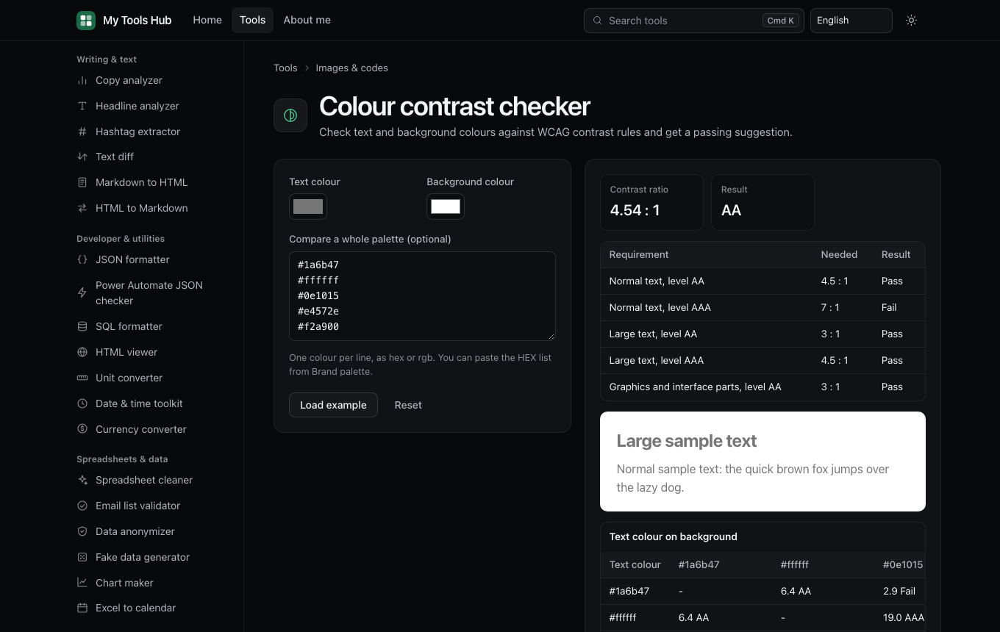<br><sub><b>Colour contrast checker</b> tests colours against WCAG and suggests the closest passing shade.</sub></td>
  </tr>
  <tr>
    <td>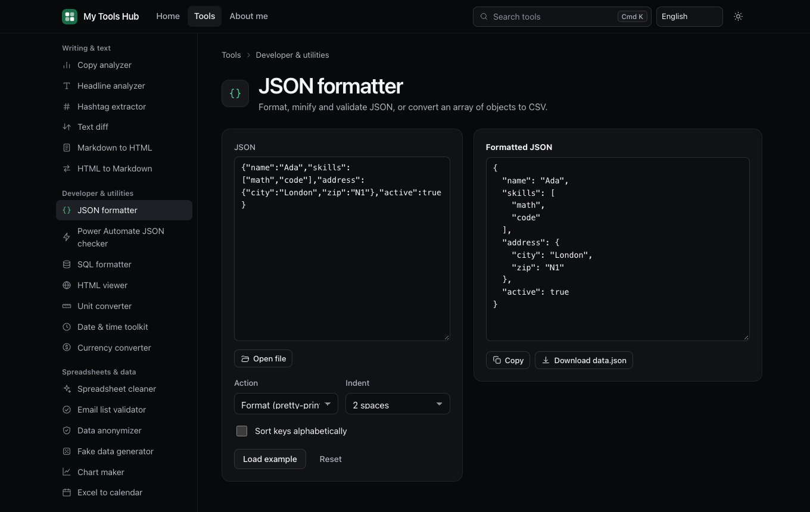<br><sub><b>JSON formatter</b> with exact line and column errors, key sorting and CSV export.</sub></td>
    <td>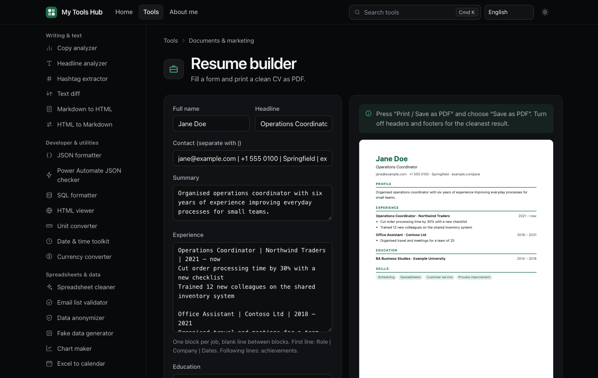<br><sub><b>Resume builder</b> with a live A4 preview. Print or save as PDF in any alphabet.</sub></td>
  </tr>
  <tr>
    <td>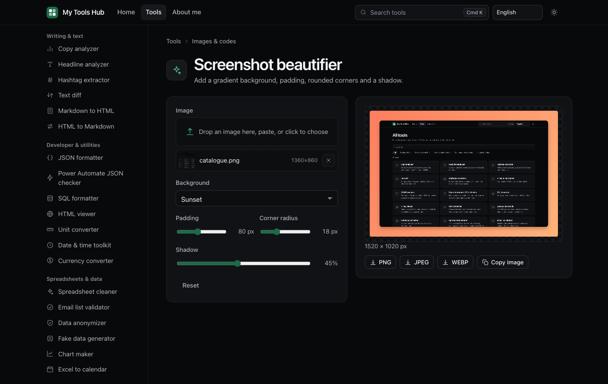<br><sub><b>Screenshot beautifier</b> adds a background, padding, rounded corners and a shadow. This repo's own screenshots were made with it.</sub></td>
    <td>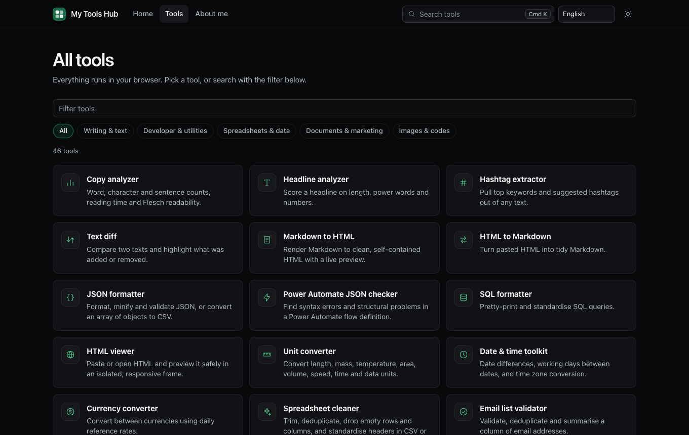<br><sub><b>One catalogue</b> for all 46 tools, with filters and instant search.</sub></td>
  </tr>
  <tr>
    <td>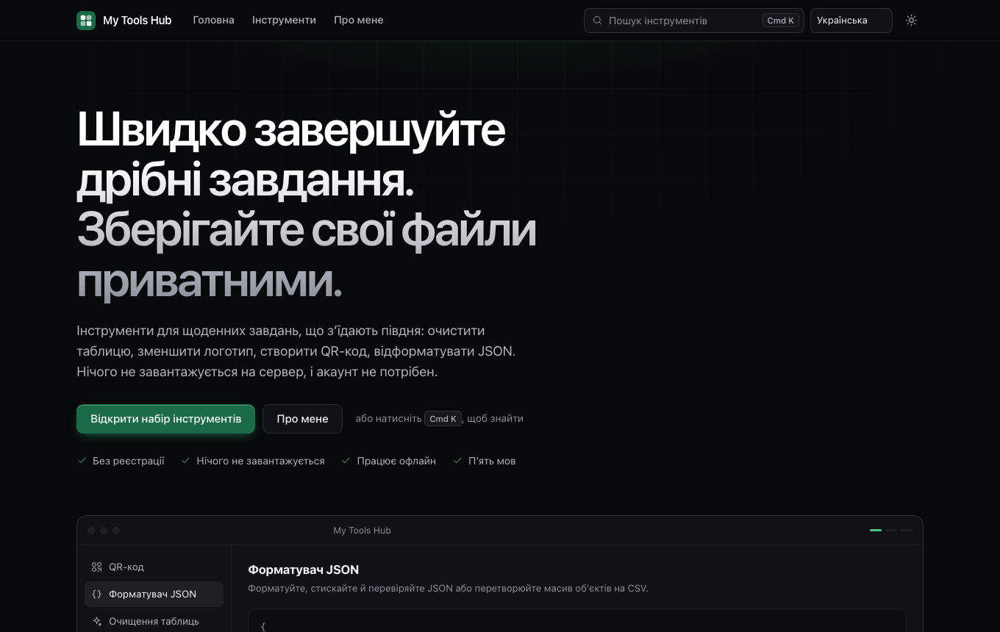<br><sub><b>Five languages</b>, switchable at any time. Shown here in Ukrainian.</sub></td>
    <td>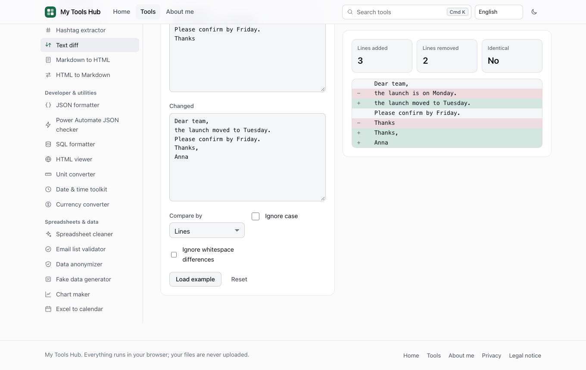<br><sub><b>Light and dark</b> themes that follow your system.</sub></td>
  </tr>
</table>

<p align="center">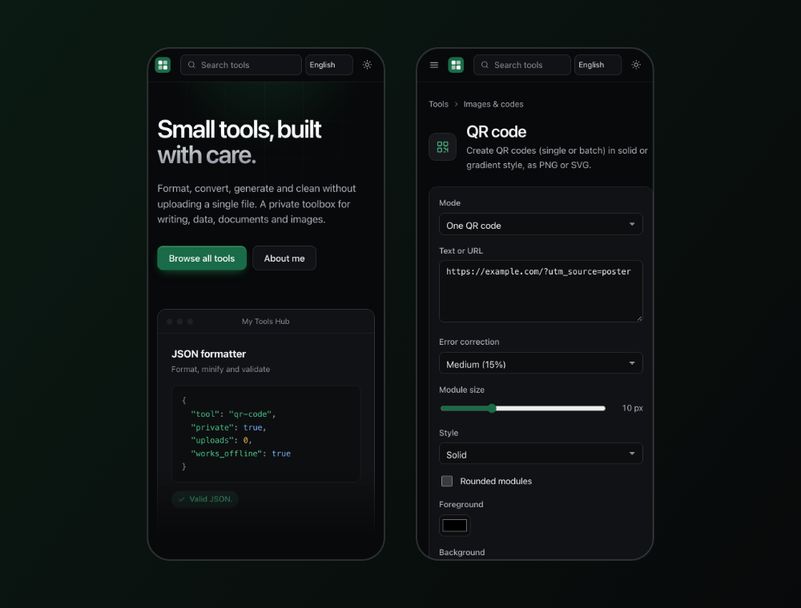</p>

## All tools

The catalogue is defined in `public/js/registry.js`.

### Writing & text

| Tool | What it does |
| --- | --- |
| **Copy analyzer** | Word, character and sentence counts, reading time and Flesch readability. |
| **Headline analyzer** | Score a headline on length, power words and numbers. |
| **Hashtag extractor** | Pull top keywords and suggested hashtags out of any text. |
| **Text diff** | Compare two texts and highlight what was added or removed. |
| **Markdown to HTML** | Render Markdown to clean, self-contained HTML with a live preview. |
| **HTML to Markdown** | Turn pasted HTML into tidy Markdown. |

### Developer & utilities

| Tool | What it does |
| --- | --- |
| **JSON formatter** | Format, minify and validate JSON, or convert an array of objects to CSV. |
| **Power Automate JSON checker** | Find syntax errors and structural problems in a Power Automate flow definition. |
| **SQL formatter** | Pretty-print and standardise SQL queries. |
| **HTML viewer** | Paste or open HTML and preview it safely in an isolated, responsive frame. |
| **Unit converter** | Convert length, mass, temperature, area, volume, speed, time and data units. |
| **Date & time toolkit** | Date differences, working days between dates, and time zone conversion. |
| **Currency converter** | Convert between currencies using daily reference rates. |

### Spreadsheets & data

| Tool | What it does |
| --- | --- |
| **Spreadsheet cleaner** | Trim, deduplicate, drop empty rows and columns, and standardise headers in CSV or Excel. |
| **Email list validator** | Validate, deduplicate and summarise a column of email addresses. |
| **Data anonymizer** | Mask emails and phone numbers and hash a chosen column in CSV or Excel. |
| **Fake data generator** | Generate locale-aware sample data (names, emails, companies…) as CSV. |
| **Chart maker** | Turn CSV or Excel columns into a bar, line or pie chart image. |
| **Excel to calendar** | Convert a sheet of events into an .ics calendar file. |

### Documents & marketing

| Tool | What it does |
| --- | --- |
| **Office to Markdown** | Convert Word, PowerPoint, Excel, HTML or CSV files to Markdown. |
| **EPUB builder** | Turn Markdown chapters into an EPUB e-book. |
| **vCard generator** | Build a .vcf contact card (single or batch from a spreadsheet) plus a QR code. |
| **Email signature** | Build a self-contained HTML email signature with a live preview. |
| **Persona builder** | Build a persona / ICP one-pager and export it as HTML or PDF. |
| **Newsletter builder** | Build a responsive HTML email newsletter with a live preview. |
| **Sell sheet** | Build a product one-pager and export it as HTML or PDF. |
| **Resume builder** | Fill a form and print a clean CV as PDF. |
| **Cover letter** | Generate a formatted cover letter and print it as PDF. |
| **Label sheet** | Lay labels out on a printable A4 grid. |
| **Roadmap maker** | Generate a roadmap / timeline graphic from milestones. |

### Images & codes

| Tool | What it does |
| --- | --- |
| **QR code** | Create QR codes (single or batch) in solid or gradient style, as PNG or SVG. |
| **Image resizer** | Resize and compress images, or generate a complete favicon pack. |
| **Image watermark** | Overlay a text or logo watermark with position, opacity and size. |
| **Social cropper** | Crop images to Instagram, Facebook, LinkedIn and X presets. |
| **Meme generator** | Add top and bottom captions to an image. |
| **Brand palette** | Extract a dominant colour palette from an image and export it as CSS. |
| **Screenshot beautifier** | Add a gradient background, padding, rounded corners and a shadow. |
| **Browser mockup** | Wrap a screenshot in a browser-window frame. |
| **Device mockup** | Place a screenshot into a phone or laptop frame. |
| **Social banner** | Generate a LinkedIn, X, Facebook or YouTube banner with a name and tagline. |
| **Certificate generator** | Create a certificate as PNG or PDF. |
| **Image converter** | Convert between PNG, JPG, WebP and BMP. |
| **Images to PDF** | Combine multiple images into one PDF (A4, Letter or fit-to-image). |

## Good to know

- **Privacy.** See the in-app Privacy page for the full notice. No cookies are used; the theme and language choice are kept in local storage.
- **Accessibility.** Targets WCAG 2.1 level AA. Every page and a sample of tools pass automated axe-core checks in both themes, and layouts reflow at 320 px. It has not had an independent audit.
- **Security.** A strict Content-Security-Policy and other headers are set in `netlify.toml`. User-supplied HTML is previewed in a sandboxed frame with scripts disabled.

## Run it yourself

You can run the site on your own machine with Node.js or with Docker. Both serve the same files with the same security headers as the Netlify deployment.

### With Node

Requires Node.js 20 or newer (used only for the dev server and checks).

```sh
npm start              # serves public/ at http://localhost:8080
npm start -- 3000      # or pick a port (also: PORT=3000 npm start)
```

The server (`scripts/serve.mjs`) applies the headers from `netlify.toml`, including the Content-Security-Policy, so what you test is what Netlify serves. No `npm install` is needed to run the app.

Checks and tests need no `npm install`; the repository has no dependencies at all:

```sh
npm run check          # registry <-> tool module consistency checks
npm test               # node --test tests/
```

`tests/qr.decode.test.mjs` can additionally verify generated QR codes with the independent jsQR decoder. jsQR is deliberately not a dependency of this repository, so this is optional and scratch-only: install it in a directory outside the repo and point `JSQR_PATH` at its entry file. Without `JSQR_PATH` (or if the path can't be loaded) those tests are skipped.

```sh
mkdir -p /tmp/jsqr-scratch && (cd /tmp/jsqr-scratch && npm install jsqr)
JSQR_PATH=/tmp/jsqr-scratch/node_modules/jsqr/dist/jsQR.js npm test
```

### With Docker

```sh
docker compose up --build            # then open http://localhost:8080
```

Or without Compose:

```sh
docker build -t my-tools-hub .
docker run --rm -p 8080:8080 my-tools-hub
```

The image is based on `node:22-alpine`, runs as an unprivileged user, has no dependencies to install, and includes a health check. Use `-p 3000:8080` to publish a different port.

## Deploy to Netlify

`netlify.toml` already configures everything: `publish = "public"`, no build command, plus security and cache headers.

1. Push the repository to GitHub, GitLab or Bitbucket.
2. In Netlify choose **Add new site → Import an existing project** and select the repository. Leave the build command empty; the publish directory comes from `netlify.toml`.
3. Deploy. Every push to the production branch redeploys.

Or, with the Netlify CLI: `npx netlify-cli deploy --prod` from the repository root.

## Add a tool

1. Add a `T(...)` entry to `TOOLS` in `public/js/registry.js` (module, category id, kebab-case tool id, icon, name, one-sentence description, search keywords).
2. Add a definition under the same id in `tools` in the matching `public/js/tools/<module>.js`, with its `fields`, an `example` and a `run()` function (put reusable logic in `public/js/lib/`).
3. Run `npm run check` and `npm test`, then try it with `npm start`.

## Project layout

```
public/            deployed site: index.html, css/, js/, icons/, sw.js, manifest
  js/registry.js   tool catalogue and search
  js/tools/        tool definitions by category (text, dev, data, docs, image)
  js/lib/          pure helpers (CSV, XLSX, PDF, QR, Markdown, ...)
  js/core/         shared UI: DOM helper, form renderer, runner, image utils
scripts/           serve.mjs (local server), check.mjs (consistency checks)
tests/             node:test suites
netlify.toml       Netlify publish directory and headers
```

## License

MIT, see `LICENSE`.
